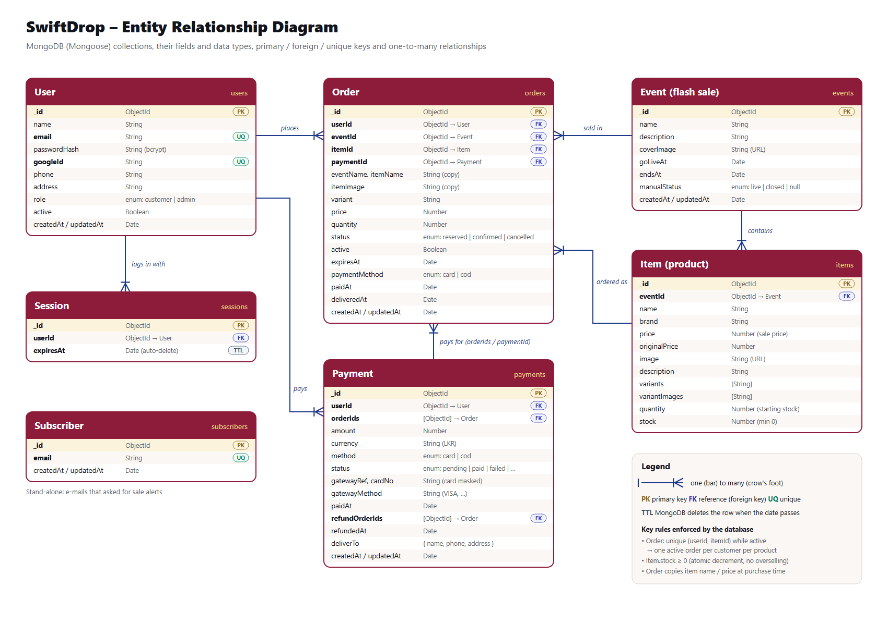

# SwiftDrop – Flash Sale Platform

A full-stack flash sale marketplace built to stay correct and responsive when **500–1,000 customers try to buy the same limited item at the same moment**.

- **Frontend:** React 18 + Vite + React Router (single-page app)
- **Backend:** Node.js + Express (routes → services → models)
- **Database:** MongoDB (Mongoose)
- **Traffic control:** Nginx as **rate limiter + load balancer** in front of **3 app servers**
- **Runs with:** Docker Compose


### Database design (ERD)



| Relationship | Type | Stored as |
|---|---|---|
| Event → Item | one sale has many products | `Item.eventId` |
| User → Order | one customer has many orders | `Order.userId` |
| Item → Order | one product is ordered many times | `Order.itemId` (+ `Order.eventId`) |
| Payment → Order | one checkout pays for one or more orders | `Payment.orderIds[]` / `Order.paymentId` |
| User → Payment | one customer makes many payments | `Payment.userId` |
| User → Session | one user can be logged in on many devices | `Session.userId` |

`Subscriber` (sale-alert e-mails) stands alone. Source of the diagram: [`docs/erd.html`](docs/erd.html).

### CRUD at a glance

The main entity is the **flash sale (Event) with its products (Items)**, managed by an admin and stored in MongoDB.

| Operation | Where in the app | API | Checks and safety |
|---|---|---|---|
| **Create** | Admin → **Create sale**: name, description, go-live / end time, cover photo, products (photo, brand, price, normal price, quantity, varieties) | `POST /api/admin/events` | Required fields, valid dates (go-live in the future, end after go-live), price > 0, normal price > sale price, quantity 100–500, images only (max 5 MB). The form checks required fields and number ranges; the server checks every rule again and returns a clear message |
| **Read** | Home, **Deals** (search, filter by sale, sort by price / discount / ending soon), **Flash sales** (tabs: live / upcoming / ended), sale page, product page; admin dashboard with sales figures | `GET /api/events`, `/api/events/:id`, `/api/items?search=`, `/api/items/:id` | Invalid IDs and missing records return a clear 400 / 404 message |
| **Update** | Admin dashboard → **Edit** on an upcoming sale | `PUT /api/admin/events/:id` | Same checks as Create. Only **upcoming** sales can be edited, so prices never change after customers have bought |
| **Delete** | Admin dashboard → **Delete** on an upcoming sale | `DELETE /api/admin/events/:id` | Asks for confirmation first. Only **upcoming** sales (no orders yet) can be deleted, so no customer order is lost; live sales are **closed** instead |

Other records with CRUD: **users** (sign up, profile edit, admin activate / deactivate), **orders** (add to cart, view history, cancel / remove from cart) and **payments** (checkout, view result, admin marks refunds done).

---

## 1. Quick start (Docker – recommended, runs everything)

Requirements: **Docker Desktop**.

```bash
# 1. Build and start Nginx + 3 app servers + MongoDB
docker compose up -d --build

# 2. Seed the database (creates the admin account, a customer, events and items)
docker compose exec app1 npm run seed

# 3. Open the site
#    http://localhost:8080
```

| Account  | Email                 | Password       |
|----------|-----------------------|----------------|
| Admin    | admin@swiftdrop.com   | `Admin@123`    |
| Customer | sarah@example.com     | `Customer@123` |

The seed creates three **live** events, four **upcoming** (locked, with countdowns) and two **ended** events.

Optional – **Continue with Google**: follow [Google sign-in](#google-sign-in) below, then run `docker compose up -d --build` again.

Stop everything: `docker compose down` (add `-v` to also delete the database).

> **Windows + OneDrive:** if `docker compose up --build` fails with `invalid file request`, the project is inside a OneDrive-synced folder (OneDrive turns files into "cloud placeholders" that Docker cannot read). Move the project to a normal folder such as `C:\Projects\swiftdrop` and run the commands again.

You can inspect the Docker database with MongoDB Compass at `mongodb://localhost:27018`.

## 2. Running without Docker (single server, for development)

Requirements: **Node.js 18+** and **MongoDB** running locally on port 27017.

Use two terminals: one for the API, one for the React app.

```bash
# Terminal 1 – API (Express)
cd backend
cp .env.example .env        # Windows: copy .env.example .env
npm install
npm run seed
npm run dev                 # API on http://localhost:3000

# Terminal 2 – web app (React + Vite)
cd frontend
npm install
npm run dev                 # open http://localhost:5173
```

Vite forwards `/api` and `/uploads` requests to the API on port 3000.

To run everything from one server instead: `cd frontend && npm run build`, then the Express server also serves the built app at http://localhost:3000.

## 3. Environment variables

| Variable              | Default                                   | What it is                                      |
|-----------------------|-------------------------------------------|-------------------------------------------------|
| `PORT`                | `3000`                                    | Port the app server listens on                  |
| `MONGO_URI`           | `mongodb://127.0.0.1:27017/swiftdrop`     | MongoDB connection string                       |
| `JWT_SECRET`          | `swiftdrop-dev-secret`                    | Secret used to sign login tokens – **change it** |
| `RESERVATION_MINUTES` | `5`                                       | Time a customer has to pay after adding to cart |
| `PUBLIC_URL`          | *(empty = the browser's address)*         | Site address, used for the payment gateway's return links |
| `COD_ENABLED`         | `true`                                    | Offer cash on delivery                          |
| `PAYHERE_MERCHANT_ID` / `PAYHERE_MERCHANT_SECRET` | *(empty = cards off)* | PayHere credentials for card payments |
| `PAYHERE_SANDBOX`     | `true`                                    | `true` = PayHere sandbox (test cards), `false` = real money |
| `PAYHERE_NOTIFY_URL`  | `PUBLIC_URL` + `/api/payments/payhere/notify` | Where PayHere reports results – **must be reachable from the internet** |
| `CHECKOUT_MINUTES`    | `15`                                      | Extra hold time while the customer is on the card page |
| `FIREBASE_PROJECT_ID` | *(empty = Google sign-in off)*            | Firebase project used to check Google sign-ins  |

In Docker these are set in `docker-compose.yml`; put your values in a `.env` file next to it (`JWT_SECRET`, `PUBLIC_URL`, `PAYHERE_*`, `FIREBASE_PROJECT_ID` …).

The web app has its own settings in `frontend/.env` (see `frontend/.env.example`). They are read when the app is built:

| Variable | What it is |
|---|---|
| `VITE_FIREBASE_API_KEY`, `VITE_FIREBASE_AUTH_DOMAIN`, `VITE_FIREBASE_PROJECT_ID`, `VITE_FIREBASE_APP_ID` | Firebase web app settings for "Continue with Google". Leave empty to hide the button |

### Google sign-in

Customers can log in or sign up with **Continue with Google** (Firebase Authentication).

1. In the [Firebase console](https://console.firebase.google.com) create a project, then **Authentication → Sign-in method → Google → Enable**.
2. **Project settings → Your apps → Add app → Web**, and copy the config values into `frontend/.env`.
3. Put the project ID in the server settings: `FIREBASE_PROJECT_ID=...` in `.env` next to `docker-compose.yml` (Docker) or in `backend/.env`.
4. Rebuild: `docker compose up -d --build`.
5. When the site runs on a real domain, add it under **Authentication → Settings → Authorized domains** (`localhost` is allowed by default).

How it works: the browser signs in with Google through Firebase and sends the Firebase ID token to `POST /api/auth/google`. The server checks the token's signature with Google's public keys, then logs in the matching account or creates a new customer. An existing account is only linked when Google has **verified** the e-mail address. Google users add their phone and address before their first purchase, and can set a password later on the Profile page.

### Payments

Customers pay for everything in their cart in one go, by **card (PayHere)** or **cash on delivery**.

- **Card:** the checkout sends the browser to PayHere's own payment page with a signed amount. An order becomes *confirmed* **only** when PayHere's server calls `/api/payments/payhere/notify` with a valid `md5sig` (checked with the merchant secret) and the exact amount. The browser can never mark anything as paid.
- **Cash on delivery:** the order is confirmed straight away; it counts as paid when an admin marks the parcel delivered. The Deliveries page shows how much cash to collect.
- If a payment arrives after the reservation ran out, the unit is taken again if any stock is left; otherwise the order is listed under **Refunds needed** on the admin dashboard. After refunding the customer in the PayHere portal, the admin presses **Mark refunded**.
- If a card payment is **charged back** by the bank, its undelivered orders are cancelled and the units go back into stock.

To test cards: create a free account at <https://sandbox.payhere.lk>, add your domain, copy the Merchant ID and Merchant Secret into `.env`, and expose the site with a public URL (e.g. `ngrok http 8080`, then `PUBLIC_URL=https://xxxx.ngrok-free.app`) so PayHere can reach the notify URL. For real payments use your live PayHere account and `PAYHERE_SANDBOX=false`.

## 4. Seeding

`npm run seed` (or `docker compose exec app1 npm run seed`) **deletes all data** in the `swiftdrop` database and creates:

- 1 **Admin** account (admins can never be created by public sign-up)
- 3 **Customer** accounts (`sarah@`, `nimal@` and `kavindi@example.com`, all with `Customer@123`)
- 9 events with 25 products (stock 100–300 each, with brands and normal prices)
- A few sample orders, so the dashboard and Deliveries page have data

---

## 5. How it handles the flash-sale rush

Full picture: [`docs/architecture.png`](docs/architecture.png).

| Layer | What it does | Where |
|-------|--------------|-------|
| **Browser** | Buy button disables on click until the server answers; stock is polled every 2 s from a tiny endpoint | `frontend/src/pages/EventDetail.jsx` |
| **Nginx rate limiter** | Per user 2 req/s on purchases, global 1,000 req/s purchase cap, per-IP 30 req/s on other API calls. Extra requests get an instant, friendly **429 JSON** instead of piling up | `nginx/nginx.conf` |
| **Nginx load balancer** | `least_conn` across `app1`, `app2`, `app3`; unhealthy servers are skipped; POSTs are never retried (no double purchase) | `nginx/nginx.conf` |
| **Stateless app servers** | Sessions, stock and orders live in MongoDB, images on a shared volume, so any server can answer any request | `docker-compose.yml` |
| **Atomic stock update** | `findOneAndUpdate({ _id, stock: { $gt: 0 } }, { $inc: { stock: -1 } })` – "take one only if any are left" in a single indivisible database step → **zero oversell** | `backend/src/services/purchaseService.js` |
| **Unique index** | `(userId, itemId)` unique while the order is active → the database blocks duplicate purchases | `backend/src/models/Order.js` |
| **Reserve → pay** | Adding to cart holds the unit; a verified payment (or a cash-on-delivery order) confirms it; removing it or a 5-minute timeout returns the unit | `purchaseService.js`, `paymentService.js` + job in `server.js` |

Response header `X-Served-By` shows which app server answered each request.

## 6. Load-test evidence

Results are saved in [`loadtest/results/`](loadtest/results).

**Zero-oversell test** – 1,000 different logged-in customers buy the same item (stock 100) at the same instant, through Nginx → 3 app servers:

```bash
docker compose exec app1 npm run test:concurrency -- http://nginx
```

```
Responses: { reserved: 100, '409 SOLD_OUT': 900 }
Stock left in DB: 0   Orders in DB: 100   Starting stock: 100
PASS: zero oversell, stock and orders match exactly.
PASS: no 5xx / network errors.
```

Normal load (NFR-04, 100 simultaneous buyers): **p95 ≈ 0.9 s** (target ≤ 2 s).

```bash
docker compose exec -e USERS=100 app1 npm run test:concurrency -- http://nginx
```

**30-second load test, 1,000 virtual users (k6)** – NFR-02 / NFR-03:

```bash
docker run --rm -i --network swiftdrop_default -e BASE_URL=http://nginx grafana/k6:0.54.0 run - < loadtest/k6-load-test.js
```

Result: 56,008 requests, **0 server errors (5xx)**, 100% JSON responses. Every virtual user comes from the same IP, so the per-IP limiter rejected most of them with a 429. That's the limiter doing its job: the app servers stayed responsive the whole time.

## 7. API overview

All errors look like `{ "error": { "code": "SOLD_OUT", "message": "Sorry, this item is sold out." } }`.

| Method | URL | Who | Purpose |
|--------|-----|-----|---------|
| POST | `/api/auth/register` | public | Create customer account |
| POST | `/api/auth/login` | public | Log in → token |
| POST | `/api/auth/google` | public | Log in / sign up with Google `{ idToken }` → token |
| POST | `/api/auth/logout` | user | End session immediately |
| GET / PUT | `/api/me` | user | View / update name, phone and delivery address |
| PUT | `/api/me/password` | user | Change password (Google-only accounts: set a first password) |
| GET | `/api/me/orders` | user | Order history |
| GET | `/api/events` | public | All events with items + status |
| GET | `/api/events/:id` | public | One event |
| GET | `/api/events/:id/stock` | public | Live stock (polled) |
| GET | `/api/items?status=live\|locked\|all&search=` | public | Products across sales (deals, search) |
| GET | `/api/items/:id` | public | One product + its sale |
| GET | `/api/items/recent-sales` | public | Latest purchases for the "just bought" pop-up (item + town only) |
| POST | `/api/subscribe` | public | Sign up for sale alerts `{ email }` |
| POST | `/api/purchase/reserve` | customer | Add to cart = reserve 1 unit `{ itemId, variant }` |
| POST | `/api/purchase/:orderId/cancel` | customer | Remove from cart, unit returns to stock |
| GET | `/api/payments/methods` | public | Which payment methods are on |
| POST | `/api/payments/checkout` | customer | Pay for reserved orders `{ orderIds, method: 'card' \| 'cod' }` |
| POST | `/api/payments/payhere/notify` | PayHere | Signed payment result (server to server) |
| GET | `/api/payments/:id` | customer | Payment status + its orders |
| GET | `/api/admin/dashboard` | admin | Events, status, units sold, revenue, refunds needed |
| POST | `/api/admin/payments/:id/refunded` | admin | Mark a refund as done |
| POST | `/api/admin/events` | admin | **Create** event (multipart form with images) |
| PUT | `/api/admin/events/:id` | admin | **Update** a locked event |
| DELETE | `/api/admin/events/:id` | admin | **Delete** a locked event |
| POST | `/api/admin/events/:id/open` / `close` | admin | Force open / close |
| GET | `/api/admin/deliveries?status=pending\|delivered&search=` | admin | Paid orders grouped by customer (one parcel each) |
| POST | `/api/admin/deliveries/:userId/delivered` | admin | Mark a customer's parcel delivered (cash on delivery counts as paid) |
| GET | `/api/admin/users?page=&search=` | admin | Paginated users |
| PATCH | `/api/admin/users/:id` | admin | Activate / deactivate `{ active }` |

## 8. Project structure

```
├── docker-compose.yml         Nginx + app1..3 + MongoDB
├── nginx/nginx.conf           Serves React app + rate limiter + load balancer
├── docs/architecture.png      Architecture diagram (source: architecture.html)
├── docs/erd.png               Database ERD (source: erd.html)
├── EDGE_CASES.md              Edge cases the platform handles
├── loadtest/                  k6 script + saved results
├── frontend/                  React + Vite web app
│   └── src/
│       ├── pages/             One component per page (customer + admin/)
│       ├── components/        Reusable UI – Navbar, DealCard, EventCard, Countdown, GoogleButton, …
│       ├── context/           Shared state – login (Auth), cart, wishlist, toast messages
│       ├── api.js             Fetch wrapper for the Express API
│       └── firebase.js        "Continue with Google" (loaded only when used)
└── backend/
    ├── scripts/               seed.js, concurrency-test.js
    └── src/
        ├── routes/            Routing layer   – thin, no business logic
        ├── services/          Business logic  – auth, events, purchase, payments, users
        ├── models/            Data access     – Mongoose schemas
        ├── middleware/        Auth check, image upload, JSON error handler
        ├── app.js / server.js
        └── config.js
```

## 9. Requirement checklist

- **Auth:** FR-A01–A06 ✔ (bcrypt hashes, signed JWT + server-side session so logout is instant, admin-only routes, no public admin sign-up, optional Google sign-in)
- **Events:** FR-E01–E06 ✔ (create with cover + item photos, Locked → Live by schedule, edit/delete only while locked, force open/close, dashboard, deactivate users)
- **Marketplace:** FR-M01–M05 ✔ (countdown, live stock without reload, Sold Out labels, automatic Sold Out state)
- **Purchase:** FR-P01–P06 ✔ (atomic reserve, instant sold-out reply, payment step, release on cancel, no duplicates, button lock, plain-language messages)
- **Profile:** FR-O01–O03 ✔
- **NFR:** zero oversell, rate limiting, load balancing, structured JSON errors, hashed passwords, layered code, README ✔
