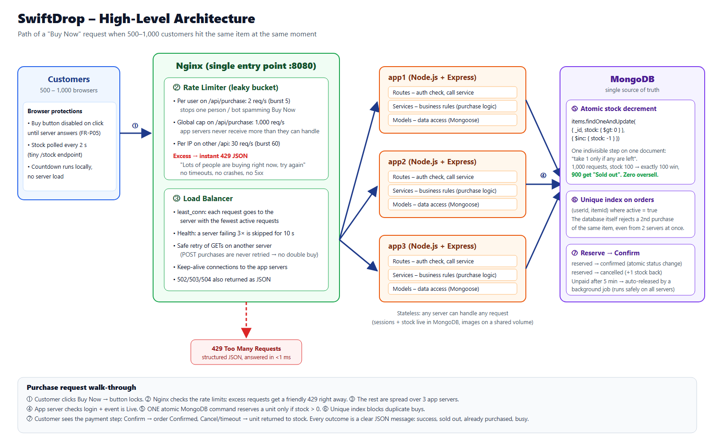

# SwiftDrop – Flash Sale Platform

A full-stack flash sale marketplace built to stay correct and responsive when **500–1,000 customers try to buy the same limited item at the same moment**.

- **Frontend:** React 18 + Vite + React Router (single-page app)
- **Backend:** Node.js + Express (routes → services → models)
- **Database:** MongoDB (Mongoose)
- **Traffic control:** Nginx as **rate limiter + load balancer** in front of **3 app servers**
- **Runs with:** Docker Compose



---

## 1. Quick start (Docker – recommended, runs everything)

Requirements: **Docker Desktop**.

```bash
# 1. Build and start Nginx + 3 app servers + MongoDB
docker compose up -d --build

# 2. Seed the database (creates the admin account, a customer, events and items)
docker compose exec app1 npm run seed

# 3. Open the site
#    http://localhost:8080
```

| Account  | Email                 | Password       |
|----------|-----------------------|----------------|
| Admin    | admin@swiftdrop.com   | `Admin@123`    |
| Customer | sarah@example.com     | `Customer@123` |

The seed creates three **live** events, four **upcoming** (locked, with countdowns) and two **ended** events.

Stop everything: `docker compose down` (add `-v` to also delete the database).

> **Windows + OneDrive:** if `docker compose up --build` fails with `invalid file request`, the project is inside a OneDrive-synced folder (OneDrive turns files into "cloud placeholders" that Docker cannot read). Move the project to a normal folder such as `C:\Projects\swiftdrop` and run the commands again.

You can inspect the Docker database with MongoDB Compass at `mongodb://localhost:27018`.

## 2. Running without Docker (single server, for development)

Requirements: **Node.js 18+** and **MongoDB** running locally on port 27017.

Use two terminals: one for the API, one for the React app.

```bash
# Terminal 1 – API (Express)
cd backend
cp .env.example .env        # Windows: copy .env.example .env
npm install
npm run seed
npm run dev                 # API on http://localhost:3000

# Terminal 2 – web app (React + Vite)
cd frontend
npm install
npm run dev                 # open http://localhost:5173
```

Vite forwards `/api` and `/uploads` requests to the API on port 3000.

To run everything from one server instead: `cd frontend && npm run build`, then the Express server also serves the built app at http://localhost:3000.

## 3. Environment variables

| Variable              | Default                                   | What it is                                      |
|-----------------------|-------------------------------------------|-------------------------------------------------|
| `PORT`                | `3000`                                    | Port the app server listens on                  |
| `MONGO_URI`           | `mongodb://127.0.0.1:27017/swiftdrop`     | MongoDB connection string                       |
| `JWT_SECRET`          | `swiftdrop-dev-secret`                    | Secret used to sign login tokens – **change it** |
| `RESERVATION_MINUTES` | `5`                                       | Time a customer has to confirm payment          |

In Docker these are set in `docker-compose.yml` (`JWT_SECRET` can be passed from your shell: `JWT_SECRET=... docker compose up -d`).

## 4. Seeding

`npm run seed` (or `docker compose exec app1 npm run seed`) **deletes all data** in the `swiftdrop` database and creates:

- 1 **Admin** account (admins can never be created by public sign-up)
- 1 **Customer** account
- 9 events with items (stock 100–300 each)

---

## 5. How it handles the flash-sale rush

Full picture: [`docs/architecture.png`](docs/architecture.png).

| Layer | What it does | Where |
|-------|--------------|-------|
| **Browser** | Buy button disables on click until the server answers; stock is polled every 2 s from a tiny endpoint | `frontend/src/pages/EventDetail.jsx` |
| **Nginx rate limiter** | Per user 2 req/s on purchases, global 1,000 req/s purchase cap, per-IP 30 req/s on other API calls. Extra requests get an instant, friendly **429 JSON** instead of piling up | `nginx/nginx.conf` |
| **Nginx load balancer** | `least_conn` across `app1`, `app2`, `app3`; unhealthy servers are skipped; POSTs are never retried (no double purchase) | `nginx/nginx.conf` |
| **Stateless app servers** | Sessions, stock and orders live in MongoDB, images on a shared volume, so any server can answer any request | `docker-compose.yml` |
| **Atomic stock update** | `findOneAndUpdate({ _id, stock: { $gt: 0 } }, { $inc: { stock: -1 } })` – "take one only if any are left" in a single indivisible database step → **zero oversell** | `backend/src/services/purchaseService.js` |
| **Unique index** | `(userId, itemId)` unique while the order is active → the database blocks duplicate purchases | `backend/src/models/Order.js` |
| **Reserve → confirm** | Stock is held on reserve; confirm marks the order confirmed; cancel or a 5-minute timeout returns the unit | `purchaseService.js` + job in `server.js` |

Response header `X-Served-By` shows which app server answered each request.

## 6. Load-test evidence

Results are saved in [`loadtest/results/`](loadtest/results).

**Zero-oversell test** – 1,000 different logged-in customers buy the same item (stock 100) at the same instant, through Nginx → 3 app servers:

```bash
docker compose exec app1 npm run test:concurrency -- http://nginx
```

```
Responses: { reserved: 100, '409 SOLD_OUT': 900 }
Stock left in DB: 0   Orders in DB: 100   Starting stock: 100
PASS: zero oversell, stock and orders match exactly.
PASS: no 5xx / network errors.
```

Normal load (NFR-04, 100 simultaneous buyers): **p95 ≈ 0.9 s** (target ≤ 2 s).

```bash
docker compose exec -e USERS=100 app1 npm run test:concurrency -- http://nginx
```

**30-second load test, 1,000 virtual users (k6)** – NFR-02 / NFR-03:

```bash
docker run --rm -i --network swiftdrop_default -e BASE_URL=http://nginx grafana/k6:0.54.0 run - < loadtest/k6-load-test.js
```

Result: 56,008 requests, **0 server errors (5xx)**, 100% JSON responses. Every virtual user comes from the same IP, so the per-IP limiter rejected most of them with a 429. That's the limiter doing its job: the app servers stayed responsive the whole time.

## 7. API overview

All errors look like `{ "error": { "code": "SOLD_OUT", "message": "Sorry, this item is sold out." } }`.

| Method | URL | Who | Purpose |
|--------|-----|-----|---------|
| POST | `/api/auth/register` | public | Create customer account |
| POST | `/api/auth/login` | public | Log in → token |
| POST | `/api/auth/logout` | user | End session immediately |
| GET / PUT | `/api/me` | user | View / update display name |
| PUT | `/api/me/password` | user | Change password |
| GET | `/api/me/orders` | user | Order history |
| GET | `/api/events` | user | All events with items + status |
| GET | `/api/events/:id` | user | One event |
| GET | `/api/events/:id/stock` | user | Live stock (polled) |
| POST | `/api/purchase/reserve` | user | Reserve 1 unit `{ itemId }` |
| POST | `/api/purchase/:orderId/confirm` | user | Confirm payment |
| POST | `/api/purchase/:orderId/cancel` | user | Cancel, unit returns to stock |
| GET | `/api/admin/dashboard` | admin | Events, status, units sold, revenue |
| POST | `/api/admin/events` | admin | **Create** event (multipart form with images) |
| PUT | `/api/admin/events/:id` | admin | **Update** a locked event |
| DELETE | `/api/admin/events/:id` | admin | **Delete** a locked event |
| POST | `/api/admin/events/:id/open` / `close` | admin | Force open / close |
| GET | `/api/admin/users?page=&search=` | admin | Paginated users |
| PATCH | `/api/admin/users/:id` | admin | Activate / deactivate `{ active }` |

## 8. Project structure

```
├── docker-compose.yml         Nginx + app1..3 + MongoDB
├── nginx/nginx.conf           Serves React app + rate limiter + load balancer
├── docs/architecture.png      Architecture diagram (source: architecture.html)
├── EDGE_CASES.md              Edge cases the platform handles
├── loadtest/                  k6 script + saved results
├── frontend/                  React + Vite web app
│   └── src/
│       ├── pages/             One component per page (customer + admin/)
│       ├── components/        Reusable UI – Navbar, EventCard, ItemCard, Countdown, …
│       ├── context/           Login state (AuthContext) + toast messages
│       └── api.js             Fetch wrapper for the Express API
└── backend/
    ├── scripts/               seed.js, concurrency-test.js
    └── src/
        ├── routes/            Routing layer   – thin, no business logic
        ├── services/          Business logic  – auth, events, purchase, users
        ├── models/            Data access     – Mongoose schemas
        ├── middleware/        Auth check, image upload, JSON error handler
        ├── app.js / server.js
        └── config.js
```

## 9. Requirement checklist

- **Auth:** FR-A01–A06 ✔ (bcrypt hashes, signed JWT + server-side session so logout is instant, admin-only routes, no public admin sign-up)
- **Events:** FR-E01–E06 ✔ (create with cover + item photos, Locked → Live by schedule, edit/delete only while locked, force open/close, dashboard, deactivate users)
- **Marketplace:** FR-M01–M05 ✔ (countdown, live stock without reload, Sold Out labels, automatic Sold Out state)
- **Purchase:** FR-P01–P06 ✔ (atomic reserve, instant sold-out reply, payment step, release on cancel, no duplicates, button lock, plain-language messages)
- **Profile:** FR-O01–O03 ✔
- **NFR:** zero oversell, rate limiting, load balancing, structured JSON errors, hashed passwords, layered code, README ✔
